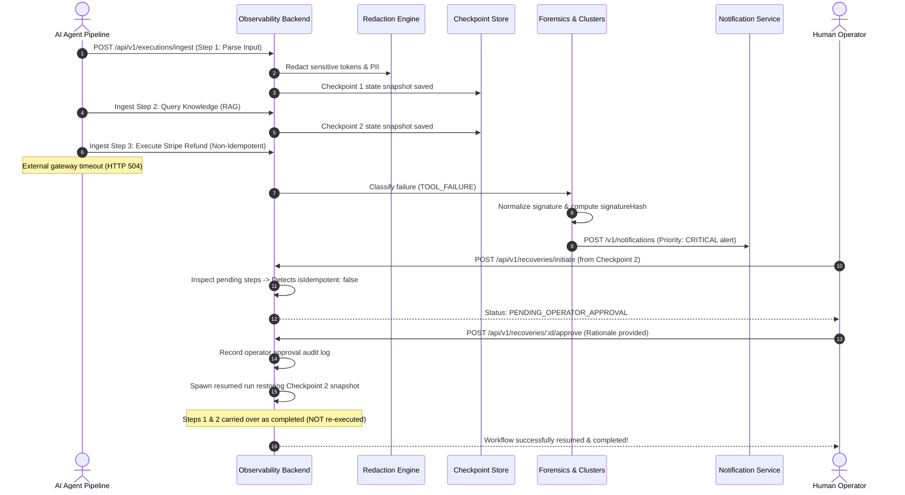

# AI Pipeline Observability & Recovery Platform

Production-grade AI Engineering platform that makes complex, multi-step AI agent workflows observable, forensic-traceable, and safely recoverable from durable checkpoints.

---

## 1. High-Level Architecture (HLD)

Modern multi-agent architectures (LangGraph, CrewAI, AutoGen, custom orchestration) fail in complex, non-deterministic ways: model rate limits, tool timeouts, schema drift, content policy denials, and flaky third-party APIs. When an agent fails after 6 steps, restarting from scratch wastes money and risks duplicate external side effects (e.g. charging credit cards, writing duplicate database records, sending duplicate emails).

`ai-pipeline-observability` provides:
1. **Hierarchical Step Execution Traces**: Captures parent-child DAG relationships between reasoning steps, tool calls, and RAG retrievals.
2. **Deep Data Sanitization**: Recursively redacts passwords, Bearer tokens, OpenAI keys (`sk-...`), Google API keys, emails, and credit cards before persistence or logging.
3. **Typed Failure Forensics & Clustering**: Classifies failures into standard typed categories (`TIMEOUT`, `MODEL_FAILURE`, `SCHEMA_FAILURE`, `TOOL_FAILURE`, `RETRIEVAL_FAILURE`, `POLICY_DENIAL`, `UNKNOWN`) and clusters recurring issues using normalized error signature hashes.
4. **Root-Cause Hypotheses with Cited Trace Evidence**: Generates structured hypotheses with explicit trace evidence citations without falsely asserting unproven claims.
5. **Durable Checkpointing & Safe Recovery**: Automatically captures state snapshots after successful milestones. Allows resuming partially completed workflows without re-executing completed non-idempotent steps.
6. **Operator Approval Guard**: Strictly requires human operator sign-off before replaying non-idempotent or externally side-effecting tools.
7. **Execution Comparison Diff Engine**: Aligns successful and failed runs side-by-side to highlight the exact step divergence point and behavioral drift.
8. **Shared Service Integrations**: Directly integrates through verified APIs with `ai-platform` (for reasoning), `notification-service` (for critical alerts), and `ai-model-regression-detection` (for model benchmarking).

```
 ┌────────────────────────────────────────────────────────────────────────┐
 │                        Next.js 14 Frontend UI                          │
 │  • Flamegraph Step Tree  • Failure Forensics  • Checkpoint Resumes    │
 │  • Side-by-Side Run Diff • Error Clusters     • Operator Approvals    │
 └───────────────────────────────────┬────────────────────────────────────┘
                                     │ REST API (/api/v1)
 ┌───────────────────────────────────▼────────────────────────────────────┐
 │                          NestJS 11 Backend                             │
 │  ┌──────────────────────────────────────────────────────────────────┐  │
 │  │ API & Ingestion Layer                                            │  │
 │  │ • Rate Limiting & Throttler • Correlation ID Middleware          │  │
 │  │ • OptionalJwtAuthGuard      • Sensitive Data Redaction Engine    │  │
 │  └──────────────────┬───────────────────────────────┬───────────────┘  │
 │                     │                               │                  │
 │  ┌──────────────────▼───────────────┐ ┌─────────────▼───────────────┐  │
 │  │ Failure Forensics & Clustering   │ │ Durable Checkpoints Engine  │  │
 │  │ • Normalized Signature Hasher    │ │ • Milestone State Snapshots │  │
 │  │ • Evidence-backed Hypotheses     │ │ • Non-idempotent Guard      │  │
 │  │ • Recovery Recommendation        │ │ • Operator Sign-off Modal   │  │
 │  └──────────────────┬───────────────┘ └─────────────┬───────────────┘  │
 │                     │                               │                  │
 │  ┌──────────────────▼───────────────────────────────▼───────────────┐  │
 │  │ Integration Adapters                                             │  │
 │  │ • AI Platform Client         (POST /api/v1/ai/chat)              │  │
 │  │ • Notification Service Client (POST /v1/notifications)           │  │
 │  │ • Model Regression Client    (POST /evaluations)                 │  │
 │  └──────────────────────────────────────────────────────────────────┘  │
 └───────────────────────────────────┬────────────────────────────────────┘
                                     │
         ┌───────────────────────────┴───────────────────────────┐
         ▼                                                       ▼
┌─────────────────────────────────┐             ┌─────────────────────────────────┐
│     MongoDB Document Store      │             │        Redis & BullMQ           │
│ (Workflows, Runs, Traces,       │             │ (Ingestion Queue, Rate Limits,  │
│  Clusters, Checkpoints, Audits) │             │  Background Forensics Engine)   │
└─────────────────────────────────┘             └─────────────────────────────────┘
```

---

## 2. Sequence Diagram: Failure Forensics, Safe Checkpointing & Operator Sign-Off



---

## 3. Data Model

### `Workflow`
- `workflowId`: Unique string ID.
- `name`, `description`, `version`, `project`, `tenantId`.
- `steps`: Array of `WorkflowStepDefinition` (`stepKey`, `name`, `type`, `isIdempotent`, `requiresApprovalToReplay`, `sideEffectDescription`, `timeoutMs`).
- `recoveryPolicy`: `autoResumeMaxAttempts`, `requireApprovalForNonIdempotent`, `backoffMs`.

### `Execution`
- `executionId`, `workflowId`, `workflowName`, `project`, `tenantId`.
- `status`: `RUNNING` | `COMPLETED` | `FAILED` | `RECOVERED` | `PAUSED` | `CANCELLED`.
- `durationMs`, `totalPromptTokens`, `totalCompletionTokens`, `totalTokens`, `estimatedCostUsd`, `retryCount`.
- `failureCategory`: `TIMEOUT` | `MODEL_FAILURE` | `SCHEMA_FAILURE` | `TOOL_FAILURE` | `RETRIEVAL_FAILURE` | `POLICY_DENIAL` | `UNKNOWN`.
- `errorSignature`, `errorSignatureHash`.
- `lastValidCheckpointId`, `isRecovered`, `recoveredFromExecutionId`.

### `TraceStep`
- `stepId`, `executionId`, `workflowId`, `stepKey`, `parentStepKey`, `parentStepId`.
- `depth`: Hierarchical nesting depth.
- `type`: `LLM_CALL` | `TOOL_EXECUTION` | `RAG_RETRIEVAL` | `DATA_TRANSFORM` | `EXTERNAL_WEBHOOK` | `VALIDATION`.
- `status`: `PENDING` | `RUNNING` | `COMPLETED` | `FAILED` | `SKIPPED`.
- `model`, `provider`, `isIdempotent`, `requiresApprovalToReplay`, `sideEffectDescription`.
- `inputPayload`, `outputPayload`: Sanitized JSON payloads.
- `errorDetails`: `{ message, stack, code, statusCode }`.
- `promptTokens`, `completionTokens`, `totalTokens`, `estimatedCostUsd`, `durationMs`.

### `Checkpoint`
- `checkpointId`, `executionId`, `workflowId`, `stepKey`, `stepOrder`.
- `stateSnapshot`: Accumulated state dictionary at checkpoint milestone.
- `completedStepKeys`: Array of completed step keys.
- `isValid`, `timestamp`.

### `RecoveryAction`
- `recoveryId`, `executionId`, `workflowId`, `actionType`, `checkpointId`, `targetStepKey`.
- `status`: `PENDING_OPERATOR_APPROVAL` | `APPROVED` | `EXECUTING` | `COMPLETED` | `REJECTED`.
- `requiresOperatorApproval`, `isIdempotent`.
- `operatorApproval`: `{ approvedBy, approvedAt, rationale, riskAssessment }`.
- `resumedExecutionId`, `createdAt`.

### `FailureCluster`
- `clusterId`, `signatureHash`, `normalizedSignature`, `category`, `frequency`.
- `firstSeenAt`, `lastSeenAt`, `affectedWorkflows`, `sampleExecutionIds`.
- `rootCauseHypothesis`: Statement, confidence score, cited evidence items, mitigation advice.
- `recoveryRecommendation`: Recommended action, explanation, safety approval flags.

---

## 4. Verified API Contracts

### Executions & Ingestion
- `POST /api/v1/executions`: Register execution run.
- `POST /api/v1/executions/ingest`: Bulk ingest execution trace with hierarchical steps and telemetry. Supports `idempotency-key` header to prevent duplicate writes on network retries.
- `POST /api/v1/executions/:id/steps`: Ingest individual step event with duration, tokens, cost, and sanitized payloads.
- `GET /api/v1/executions`: Filter runs by `project`, `status`, `workflowId`, `failureCategory`, `minLatencyMs`, `maxLatencyMs`, and `search`.
- `GET /api/v1/executions/:id`: Fetch complete execution summary, step traces, checkpoints, recoveries, and cluster diagnostics.
- `GET /api/v1/executions/:id/timeline`: Hierarchical tree / flamegraph representation with durations.

### Checkpoints & Recovery
- `POST /api/v1/checkpoints`: Record durable milestone state snapshot.
- `GET /api/v1/checkpoints/execution/:id`: Retrieve valid checkpoints for execution.
- `POST /api/v1/recoveries/initiate`: Initiate recovery. Automatically verifies if target steps are non-idempotent; if so, transitions to `PENDING_OPERATOR_APPROVAL`.
- `POST /api/v1/recoveries/:id/approve`: Operator approval endpoint. Requires operator rationale before spawning safe resumed run.
- `GET /api/v1/recoveries`: List all recovery actions.

### Failure Forensics & Clusters
- `GET /api/v1/failures/clusters`: List error clusters grouped by normalized signature hashes.
- `GET /api/v1/failures/clusters/:hash`: Fetch cluster root-cause hypothesis, cited trace evidence, and sample runs.

### Run Comparisons (Diff Engine)
- `GET /api/v1/comparisons?baseRunId=...&targetRunId=...`: Side-by-side run comparison diff. Pinpoints initial divergence point and metric deltas.

### Health & Observability
- `GET /health`: Platform health check (memory usage, database connection, queue status).
- `GET /health/live`: Kubernetes liveness probe.
- `GET /health/ready`: Kubernetes readiness probe.

---

## 5. Security & Sensitive Data Redaction

1. **Automatic Ingestion Redaction**:
   - Matches and redacts sensitive keys: `password`, `secret`, `token`, `api_key`, `authorization`, `credit_card`, `ssn`, `cookie`.
   - Normalizes text patterns:
     - JWT tokens (`eyJ...` -> `[REDACTED_JWT_TOKEN]`)
     - Bearer tokens (`Bearer ...` -> `Bearer [REDACTED_TOKEN]`)
     - OpenAI API keys (`sk-...` -> `[REDACTED_API_KEY]`)
     - Google API keys (`AIza...` -> `[REDACTED_GOOGLE_API_KEY]`)
     - Email PII -> `[REDACTED_EMAIL]`
     - Credit Card numbers -> `[REDACTED_CREDIT_CARD]`
2. **Authentication & Public Mode**:
   - Demo mode enables anonymous exploration of seeded scenarios and public workflows.
   - Protected endpoints require authenticated JWT Bearer token or service key (`x-api-key`).
   - Operator approvals and recovery policy modifications strictly require operator credentials.
3. **Rate Limiting**:
   - Per-IP and per-tenant rate limits enforced via `@nestjs/throttler`.

---

## 6. Shared Service Integrations (Audited Contracts)

### A. Shared AI Platform (`rishank-kesarwani/ai-platform`)
- **Endpoint**: `POST /api/v1/ai/chat`
- **Auth Header**: `x-api-key: ${AI_PLATFORM_OBSERVABILITY_API_KEY}`
- **Usage**: Diagnostic summaries and root-cause reasoning.
- **Contract**: Accepts `applicationId`, `tenantId`, `message`, `systemInstruction`. Responds with `answer`, `citations`, `usage`, `model`, `latencyMs`.
- **Fault Tolerance**: Resilient local evidence fallback if external AI Platform is offline or unreachable.

### B. Notification Service (`rishank-kesarwani/notification-service`)
- **Endpoint**: `POST /v1/notifications`
- **Auth Header**: `x-api-key: ${NOTIFICATION_OBSERVABILITY_API_KEY}`
- **Usage**: Dispatches actionable email alerts for critical workflow failures or repeated errors.
- **Contract**: Accepts `idempotencyKey`, `priority: "CRITICAL"`, `channels: ["EMAIL"]`, `recipient: { userId, email }`, `email: { subject, text, html }`, `metadata`.
- **Payload Safety**: Transmits only sanitized correlation ID, workflow name, error class, and dashboard link. Never sends API keys or raw user payloads.

### C. AI Model Regression Detection (`rishank-kesarwani/ai-model-regression-detection`)
- **Endpoint**: `POST /api/v1/evaluations`
- **Auth Header**: `Authorization: Bearer ${MODEL_REGRESSION_API_KEY}`
- **Usage**: Triggers model benchmark evaluations when assessing candidate model versions across observed workflows. Does not duplicate its evaluator registry or baseline engine.

---

## 7. Deployment Configuration

### Render / Railway Settings
- **Port Binding**: Respects `process.env.PORT` dynamically and binds server to `0.0.0.0`.
- **Health Endpoint**: Stable `/health` endpoint returning HTTP 200 with JSON status payload.
- **Redis Connection**: Supports verified public Redis URLs via `REDIS_URL` or localhost fallback.
- **Dual-Mode Persistence**: Seamlessly uses MongoDB when connected, with automatic in-memory collection fallback during offline testing or local development.

---

## 8. Verification & Test Commands

### Run Unit & Integration Tests:
```bash
npm test
```
All 6 test suites and 15 tests pass:
- Execution ingestion & metric rollups
- Sensitive data redaction
- Error normalization & failure classification
- Durable checkpointing & safe resume
- Resuming partially completed workflow without rerunning completed non-idempotent steps
- Operator approval workflow & authentication

### Run Production Build:
```bash
npm run build
```
Builds NestJS backend (`nest build`) and Next.js frontend (`next build`) cleanly with zero errors.
